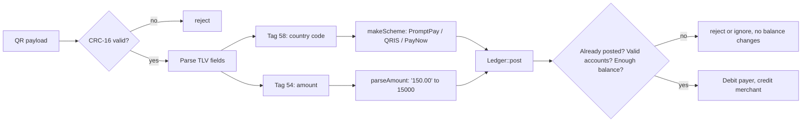

# Cross-Border ASEAN EMVCo QR Payment Switch
[](https://github.com/fazlialghani/ASEAN-EMVCo-QR-Payments-Switch/actions/workflows/ci.yml)
A C++20 payment switch that settles cross-border QR payments across ASEAN, from QRIS to PromptPay to PayNow. Every payment is applied exactly once, every balance reconciles, and a corrupted QR never reaches the ledger.

> **Simulation.** This project follows the EMVCo Merchant-Presented QR format but is not certified and is not connected to any real payment network.

---

## Why this exists

An Indonesian tourist scans a Thai merchant's QR code in Bangkok. Behind that one tap, a switch has to answer four questions before any money moves:

1. **Is the QR intact?** A scratched sticker or a misread digit can turn `150.00` into `950.00`.
2. **Which network is this?** QRIS, PromptPay and PayNow share one format but settle in different currencies.
3. **How much, exactly?** Money cannot be a `double`; `0.1 + 0.2` is not `0.3`.
4. **Has this payment already happened?** Phones retry on a dropped connection. A retry must never charge twice.

This switch answers all four, and the test suite proves it.

---

## How a payment flows



Using the real Bangkok payload from the tests:

| Step | Input | Result |
|---|---|---|
| CRC check | `...6304C871` | recomputed CRC is `C871`, payload accepted |
| TLV parse | 118 characters | 10 top-level fields |
| Tag 58 | `TH` | `PromptPayScheme`, currency THB |
| Tag 54 | `150.00` | `15000` minor units |
| Post | tourist → merchant | tourist −15000, merchant +15000 |
| Same transaction id again | `p1` | ignored, balances unchanged |

---

## Features

- **Hand-written EMVCo TLV parser.** Reads `tag | length | value` fields and rejects truncated payloads and non-digit lengths. A failed parse leaves the caller's data untouched.
- **CRC-16/CCITT-FALSE validation.** Implemented bit by bit and verified against the standard check value (`"123456789"` → `0x29B1`).
- **Three payment schemes behind one interface.** `PaymentScheme` is an abstract base class; `makeScheme` returns a `std::unique_ptr` to the right scheme based on EMVCo tag 58.
- **Double-entry ledger.** Every transfer debits one account and credits another by the same amount. Customer accounts can never go negative; only settlement accounts can.
- **Exactly-once posting.** The ledger remembers every successfully posted transaction id, so a retried request is ignored instead of charging twice.
- **No floating point anywhere.** Amounts are `int64_t` minor units, and `"150.00"` is parsed digit by digit into `15000`.

---

## Design decisions

| Decision | Why |
|---|---|
| Money is `int64_t` minor units with a `Currency` enum | Floating point cannot represent most decimal amounts exactly. Mixing currencies throws instead of silently producing a wrong total. |
| `post()` checks every rule before changing anything | If any check fails, no balance changes and the transaction id is not recorded, so the same payment can be retried later. |
| A duplicate transaction id is ignored, not rejected | The client retrying a request usually does not know the first attempt succeeded. Ignoring it returns the same outcome as the first call. |
| Settlement accounts may go negative | Money enters the system through settlement accounts, so the sum of all balances in each currency is always exactly zero. That sum is the ledger's invariant. |
| `Ledger` follows the rule of zero | Its members are standard containers that already copy, move and free themselves. There is no raw pointer to manage. |
| `makeScheme` returns `std::unique_ptr<PaymentScheme>` | The concrete scheme is only known at runtime, and ownership is released automatically. No manual `new` or `delete`. |

---

## Build and test

Requires a C++20 compiler (GCC or Clang) and `make`.

```bash
make test     # builds and runs every test program
make clean    # removes build outputs
```

All code compiles with `-std=c++20 -Wall -Wextra -pedantic` and zero warnings.

### Example

```cpp
#include "ledger.h"
#include "switch.h"

Ledger led;
led.addAccount("settle_thb", Currency::THB, true);   // settlement, may go negative
led.addAccount("tourist",    Currency::THB, false);
led.addAccount("somtam",     Currency::THB, false);

led.post(Transaction{"topup-1", "settle_thb", "tourist", Money{Currency::THB, 50000}});

processPayment(led, "pay-1", bangkokPayload, "tourist", "somtam");
// tourist: 35000, somtam: 15000

processPayment(led, "pay-1", bangkokPayload, "tourist", "somtam");
// retried with the same id: nothing changes
```

---

## Testing

| Suite | What it proves |
|---|---|
| `test_money` | Currency-safe arithmetic, comparison and formatting |
| `test_tlv` | Parsing valid payloads; rejecting truncated input and bad lengths; failed parses leave output unchanged |
| `test_crc` | CRC-16 matches the standard check value; corrupting one character is detected |
| `test_scheme` | Each scheme reports the right name, currency and country; unknown countries throw |
| `test_ledger` | Unknown accounts, same-account transfers, mixed currencies, overdrafts and non-positive amounts are rejected with no side effects; duplicate ids are applied once; failed ids can be retried |
| `test_ledger` (randomized) | **100,000 random transfers** with a fixed seed; the ledger invariant (every currency sums to zero) is checked after every single transfer |
| `test_switch` | The full Bangkok payload moves exactly 150.00 THB once; a resend changes nothing; a corrupted payload is rejected |

---

## Fuzzing

The TLV parser, CRC check and amount parser are fuzzed with libFuzzer under
AddressSanitizer and UndefinedBehaviorSanitizer, seeded from `corpus/`
(12 valid payloads across PromptPay, QRIS and PayNow).

- **90M+ generated inputs** in a 30-minute run with no crashes.
- The fuzzer found a **signed integer overflow** in `parseAmount` within two
  seconds: a 20-digit amount overflowed `int64_t`. Amounts are now limited to
  the 13 characters EMVCo allows, and the crashing input is kept as a
  regression test.

Run it yourself from the **Actions → Fuzz → Run workflow** button.

---

## Project structure

```
include/   public headers (money, currency, tlv, crc, transaction, ledger, scheme, switch)
src/       implementations
tests/     one test program per module, run by `make test`
```

---

## Limitations

- Each payment settles in a single currency. Cross-currency conversion (for example IDR to THB) is planned for v1.1.
- Nested templates inside tag 26 (merchant account information) are kept as one string and not parsed further.
- The CRC detects accidental corruption, not deliberate tampering. Protecting against forged QR codes would require digital signatures.
- The ledger lives in memory; transaction logging and replay after restart are planned for v1.1.

---

## Roadmap

- **v1.1:** fixed-point FX conversion with a rounding-remainder account, transaction log with replay on startup, Observer-based audit logging and Decorator-based fraud rules.
- **v2.0:** a PyTorch fraud model served inside the C++ transaction path, with an inference benchmark across backends.